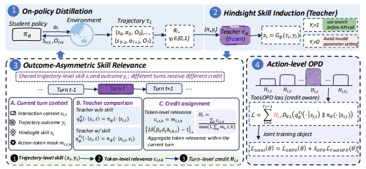
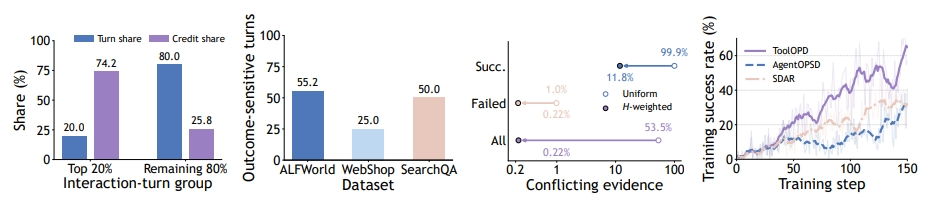
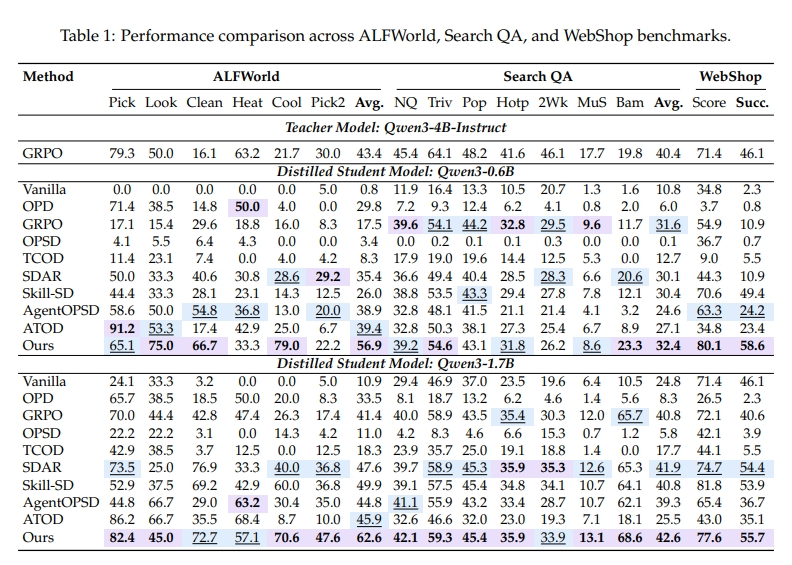

<h1 align="center" style="text-align: center;">
ToolOPD
</h1>

<p align="center" style="text-align: center;">
Credit-Aware On-Policy Distillation for Tool-Use Agent
</p>

## 🔥 Overview

**ToolOPD** is a **credit-aware on-policy distillation** framework for tool-use agents in long-horizon tasks. Standard on-policy distillation (OPD) provides dense, token-level teacher supervision on student-generated trajectories, but assigns the same supervision strength to different actions. Our credit-distribution analysis and outcome-reversal counterfactual experiments show that credit is concentrated on a small number of critical actions and depends on the final outcome, even when the trajectory is held fixed.

ToolOPD uses completed trajectories and their outcomes to identify which teacher signals support useful decisions:

1. **Hindsight skill construction.** Summarize each completed trajectory and its outcome into a reusable hindsight skill.
2. **Action credit estimation.** Measure how this skill changes the teacher's probability of each student action token and convert the change into action credit informed by the trajectory outcome.
3. **Selective supervision.** Preserve supervision that supports successful decisions or discourages failed ones, while suppressing irrelevant and conflicting signals.
4. **Joint optimization.** Reweight the action-level distillation loss with these credits and jointly optimize it with reinforcement learning.

<p align="center" style="text-align: center;">
  
</p>

## 📄 Abstract

On-policy distillation (OPD) enhances the capabilities of small language agents by providing dense, token-level supervision from a teacher model on student-generated trajectories. However, standard OPD implicitly assumes that credit is uniformly distributed across long-horizon trajectories, assigning the same strength of teacher supervision to different actions. Through credit-distribution analysis and outcome-reversal counterfactual experiments, we find that trajectory credit is concentrated on a small number of critical actions. Moreover, even when the trajectory is held fixed, reversing only the final outcome substantially changes the credit assigned to multiple interaction turns. These findings show that the uniform-credit assumption fails to identify critical decisions and ultimately degrades the model's reasoning accuracy. To address these challenges, we propose ToolOPD, a credit-aware on-policy distillation framework designed for tool-use agents in long-horizon tasks. ToolOPD first summarizes each completed trajectory and its outcome into a reusable hindsight skill. It then measures how this skill changes the teacher's probability of each student action token and converts the change into action credit informed by the trajectory outcome. The resulting credit preserves supervision that supports successful decisions or discourages failed ones, while suppressing irrelevant and conflicting signals. ToolOPD uses these credits to reweight the action-level distillation loss and jointly optimizes it with reinforcement learning. Extensive experiments across multiple long-horizon tool interaction benchmarks demonstrate that ToolOPD significantly outperforms existing reinforcement learning and self-distillation baselines.

## 🔍 Credit Analysis

Our analysis motivates credit-aware supervision in two ways:

- **Concentrated credit.** A small number of critical actions account for much of the trajectory credit.
- **Outcome-dependent credit.** Reversing only the final outcome substantially changes the credit assigned to multiple interaction turns, even when the trajectory remains fixed.

<p align="center" style="text-align: center;">
  
</p>

## 📖 Results

Extensive experiments across multiple long-horizon tool interaction benchmarks demonstrate that ToolOPD significantly outperforms existing reinforcement learning and self-distillation baselines.

<p align="center" style="text-align: center;">
  
</p>

## 🛠️ Installation

### Python environment

```bash
conda create -n toolopd python==3.12 -y
conda activate toolopd

pip3 install vllm==0.11.0
pip3 install flash-attn==2.7.4.post1 --no-build-isolation --no-cache-dir
pip install -e .
```

Log in to Weights & Biases if you use WandB logging (scripts pass `trainer.logger=['console','wandb']`):

```bash
export WANDB_API_KEY=your_key_here
```

### Install Supported Environments

#### 1. ALFWorld

```bash
pip3 install gymnasium==0.29.1
pip3 install stable-baselines3==2.6.0
pip3 install alfworld
alfworld-download -f   # PDDL & game files + MaskRCNN detector, stored in ~/.cache/alfworld/
```

#### 2. WebShop

WebShop requires Python <=3.10, so create a separate environment:

```bash
conda create -n verl-webshop python==3.10 -y
conda activate verl-webshop

cd ./agent_system/environments/env_package/webshop/webshop
./setup.sh -d all

cd repo_root/
pip3 install torch==2.6.0 --index-url https://download.pytorch.org/whl/cu124
pip3 install flash-attn==2.7.4.post1 --no-build-isolation
pip3 install -e .
pip3 install vllm==0.8.2
```

The `typer` version warnings can be safely ignored.

#### 3. Search

```bash
cd ./agent_system/environments/env_package/search/third_party
pip install -e .
pip install gym==0.26.2

cd repo_root/
python examples/data_preprocess/preprocess_search_r1_dataset.py   # -> ~/data/searchR1_processed_direct
```

Set up a separate retriever environment (faiss-gpu is not available via pip). The retrieval server
uses ~6GB GPU memory per GPU:

```bash
conda create -n retriever python=3.10 -y
conda activate retriever
conda install numpy==1.26.4
pip install torch==2.6.0 torchvision==0.21.0 torchaudio==2.6.0 --index-url https://download.pytorch.org/whl/cu124
pip install transformers datasets pyserini huggingface_hub
conda install faiss-gpu==1.8.0 -c pytorch -c nvidia -y
pip install uvicorn fastapi
```

Download the index and start the retrieval server:

```bash
conda activate retriever
local_dir=~/data/searchR1
python examples/search/searchr1_download.py --local_dir $local_dir
cat $local_dir/part_* > $local_dir/e5_Flat.index
gzip -d $local_dir/wiki-18.jsonl.gz

bash examples/search/retriever/retrieval_launch.sh > retrieval_server.log
```

## 🚀 Training

Run commands from the repository root. ToolOPD training scripts are available under `examples/tool_trainer/`, with the Python entry point `verl.trainer.main_tool_opd`.

Configure the student and teacher model paths before launching ALFWorld training:

```bash
export STUDENT_MODEL_PATH=/path/to/student
export TEACHER_MODEL_PATH=/path/to/teacher
bash examples/tool_trainer/run_alfworld_qwen3_0_6B.sh vllm
```

| Environment | Qwen3-0.6B                     | Qwen3-1.7B                     |
| ----------- | ------------------------------ | ------------------------------ |
| ALFWorld    | `run_alfworld_qwen3_0_6B.sh` | `run_alfworld_qwen3_1_7B.sh` |
| SearchQA    | `run_searchqa_qwen3_0_6B.sh` | `run_searchqa_qwen3_1_7B.sh` |
| WebShop     | `run_webshop_qwen3_0_6B.sh`  | `run_webshop_qwen3_1_7B.sh`  |

The student and teacher currently need to share the same tokenizer so their action-token probabilities align. See `examples/tool_trainer/README.md` and the selected launcher for implementation details, dataset paths, GPU settings, and hyperparameters.

Additional launchers for ALFWorld, WebShop, and Search-QA are available in `examples/tool_trainer/`. Configure their model, dataset, and output paths for your environment before use.

Baseline training scripts are also provided under `examples/`.

### Merge checkpoints

See `scripts/model_merger.py` for FSDP/Megatron merge examples using paths under `./checkpoints/...`.

## ⭐️ Citation

**TODO**

## 🤝 Acknowledgement

ToolOPD builds on open-source reinforcement learning and agent frameworks and uses the ALFWorld, WebShop, and Search-R1 environments. We thank the authors and contributors of these projects.
